# ⏱️ TimeMachine

<div align="center">


[](LICENSE)

**A comprehensive productivity & health tracking app for Android built with Jetpack Compose**

Focus Tracker • Screen Time • Habit Tracker • Year Calculator • BMI Calculator • Expense Tracker • Subscription Tracker • Daily Planner

[Download APK](https://github.com/LiLabsAI/TimeMachine/releases/latest) • [Report Bug](https://github.com/LiLabsAI/TimeMachine/issues) • [Request Feature](https://github.com/LiLabsAI/TimeMachine/issues)

</div>

---

## 📱 Screenshots

<div align="center">

### Home & Navigation
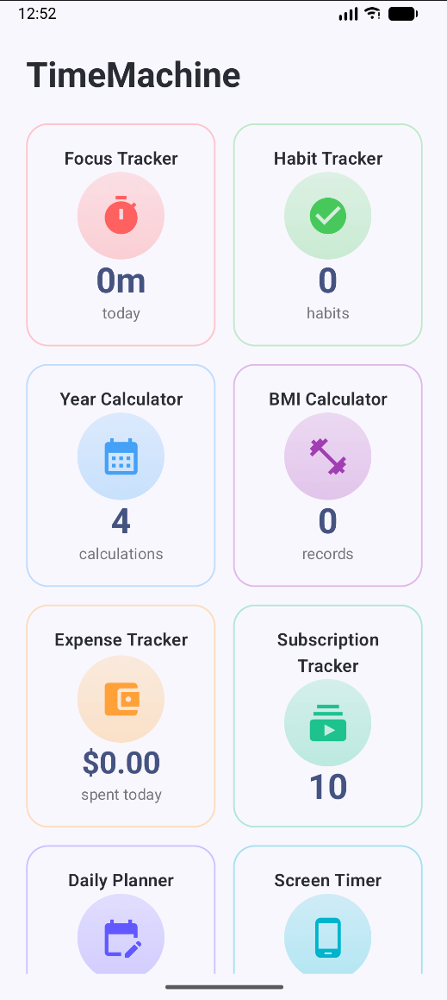 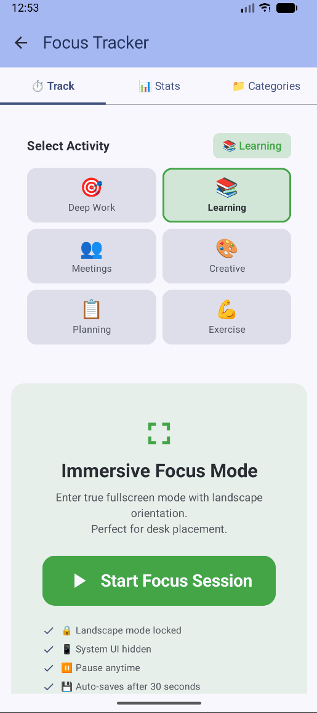 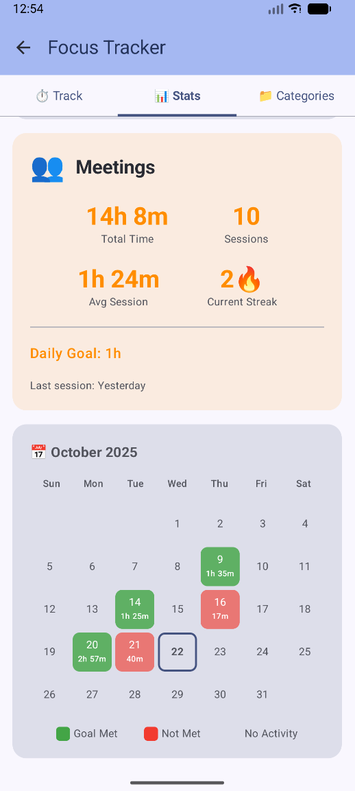

### Focus Tracker & Screen Time
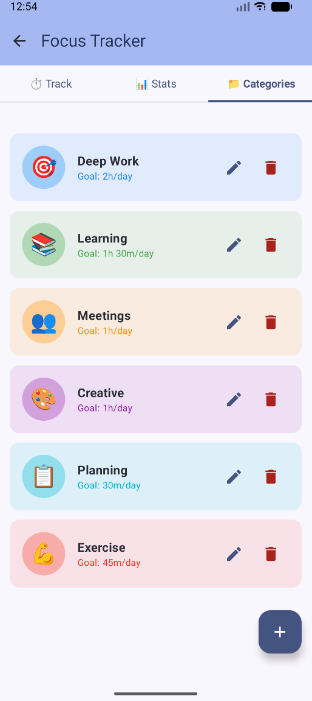 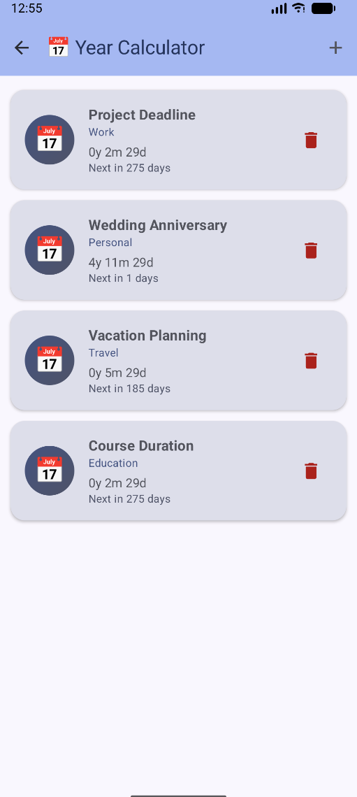 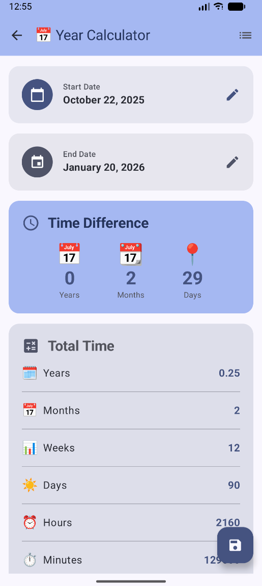

### Habit Tracker
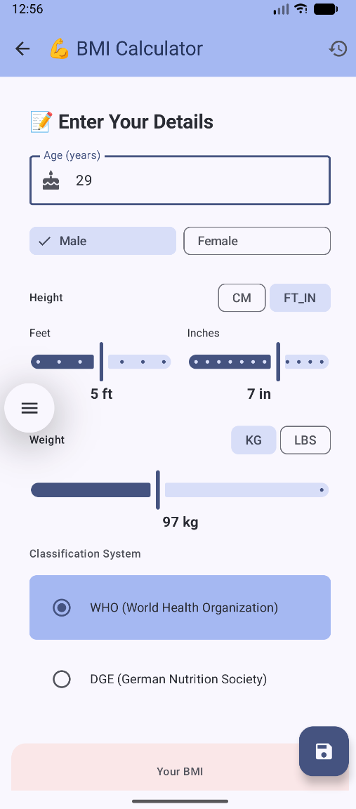 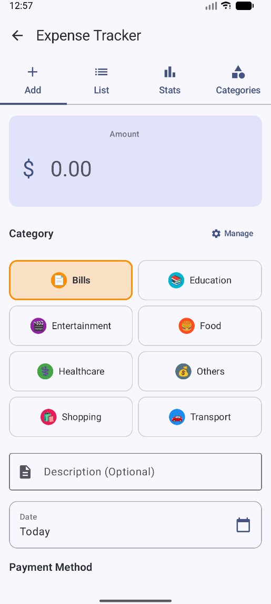 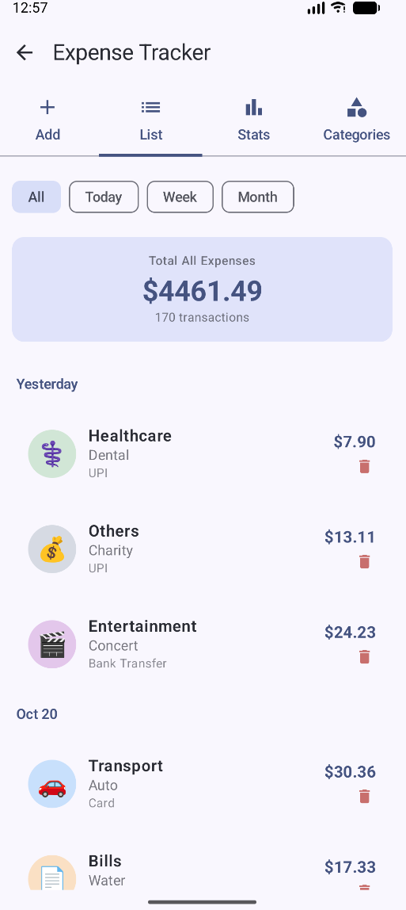

### Expense & Subscription Tracker
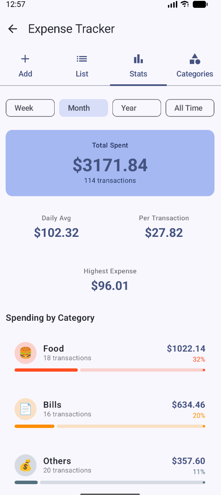 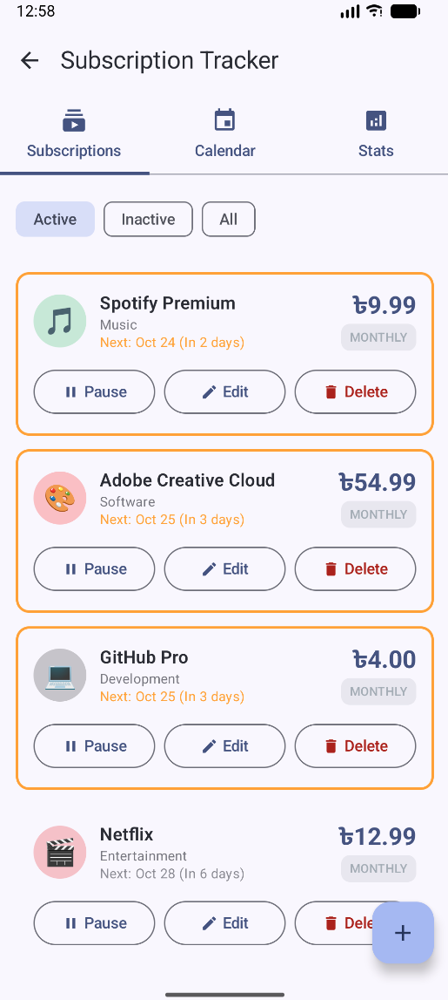 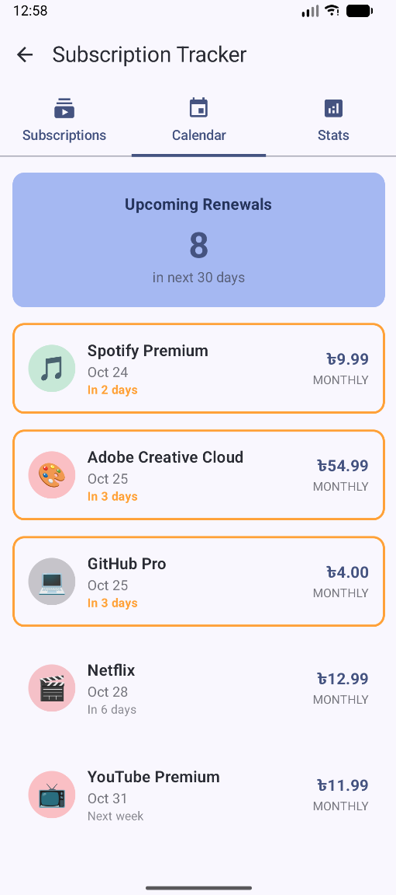

### Daily Planner & Calculators
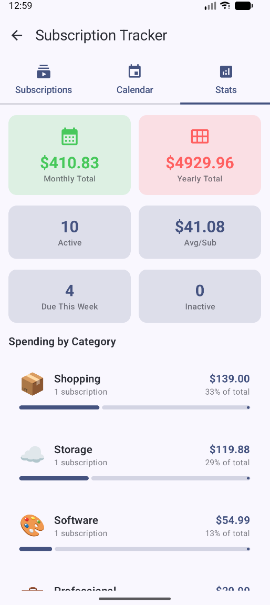 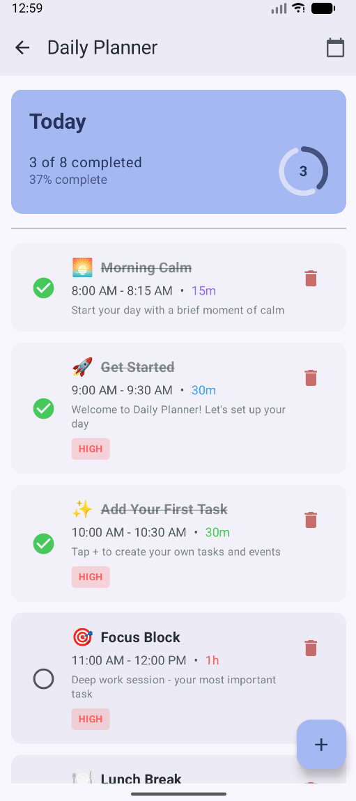 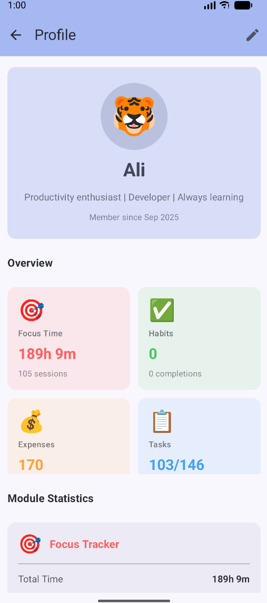

### Settings & Data Management
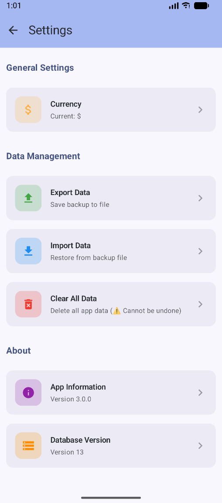 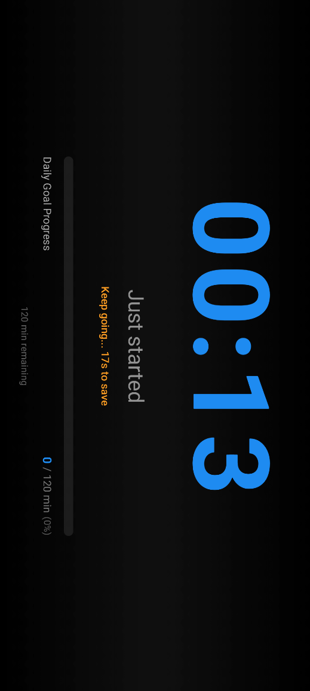

</div>

## ✨ Features

### 🎯 Core Functionality
- **⏰ Custom Duration** - Set any duration from 1 minute to 23 hours 59 minutes
- **⏱️ Real-Time Countdown** - Watch the timer count down with visual progress indicator
- **📱 Background Service** - Timer continues running even when app is closed
- **🔔 Persistent Notification** - Always-visible countdown in status bar and notification shade
- **🔔 Alarm Sound** - System alarm plays when timer completes
- **📳 Vibration** - Physical feedback with repeating vibration pattern
- **🛑 Stop Anytime** - Cancel the timer from app or notification

### 🎨 User Experience
- **Apple-Style Picker** - Smooth, scrollable wheels for time selection (just like iOS)
- **Circular Progress** - Beautiful circular indicator shows remaining time
- **Minimal Design** - Clean, distraction-free interface
- **Smooth Animations** - Polished transitions between states
- **Large Touch Targets** - Easy to use with one hand

### 🌓 Appearance
- **Auto Dark/Light Mode** - Follows your system preferences
- **Material 3 Design** - Modern Android design language
- **Clean Colors** - Blue accent with high contrast
- **Edge-to-Edge** - Immersive full-screen experience

### 🔧 Technical
- **Compact Release** - ~25 MB R8-minified APK across 5 core pillars & utilities
- **No Ads** - Completely ad-free experience
- **No Internet Required** - Works 100% offline
- **Room Database v14 + DataStore** - Exported schemas, verified migrations, and isolated user preferences
- **Lifecycle Aware** - Unidirectional data flow with ViewModels & `StateFlow`
- **Live Focus & Reminders** - Elapsed-time `FocusTimerService`, Android 16/17 Live Updates, and inline notification actions
- **WorkManager** - Battery-efficient background sync, budget alerts, and daily digests
- **UsageStats & Glance** - App-attributed screen time analytics, Quick Settings tiles, and Home Screen widgets
- **ProGuard Optimized** - Minified and resource-shrunk for release performance

---

## 📥 Installation

### Download APK
1. Go to [Releases](https://github.com/LiLabsAI/TimeMachine/releases/latest)
2. Download `TimeMachineV3.1.0.apk`
3. Enable "Install from Unknown Sources" in your Android settings
4. Open the APK and install

### Minimum Requirements
- **Android 12 (API 31) or higher**
- **ARM or x86 processor**
- **~60MB free storage** (~25 MB release APK + local data)

---

## 🚀 Usage

### Setting a Timer

1. **Open the app** - Launch TimeMachine
2. **Set duration** - Scroll the time wheels to select hours and minutes
   - Default is 25 minutes (perfect for focus sessions)
3. **Tap Start** - Big blue button starts the countdown
4. **Background mode** - Notification appears with countdown
5. **Close app** (optional) - Timer continues running in background
6. **Get notified** - Alarm sound + vibration when complete (even if app is closed)
7. **Dismiss** - Tap to stop the alarm

### Background Operation

- **Persistent notification** - Shows remaining time in status bar
- **Stop from notification** - Use "Stop" button without opening app
- **Tap to return** - Tap notification to see full timer
- **Survives closure** - Timer runs even if you force-close the app
- **Lock screen safe** - Continues running when screen is locked

### Focus Timer Technique

The classic Focus Timer technique:
1. **Work**: Set timer for 25 minutes and focus
2. **Short break**: Set timer for 5 minutes and rest
3. **Repeat**: After 4 pomodoros, take a longer 15-30 minute break

### Other Use Cases
- 🏋️ **Workout intervals** - HIIT, rest periods, exercise durations
- 🧘 **Meditation** - Timed meditation sessions
- 👨‍🍳 **Cooking** - Track cooking times
- ☕ **Coffee brewing** - Perfect pour-over timing
- 📚 **Study sessions** - Focused learning blocks
- 🎮 **Screen time limits** - Gaming or social media breaks
- 🧺 **Chores** - Time-boxed cleaning sessions

---

## 🛠️ Build from Source

### Prerequisites
- **Android Studio** Hedgehog (2023.1.1) or later
- **JDK 11** or higher
- **Android SDK** with API 36
- **Git**

### Clone & Build

```bash
# Clone the repository
git clone https://github.com/LiLabsAI/TimeMachine.git
cd TimeMachine

# Build debug APK
./gradlew assembleDebug

# Build release APK (requires keystore)
./gradlew assembleRelease

# Install on connected device
./gradlew installDebug
```

### Project Structure
```
TimeMachine/
├── app/
│   ├── schemas/                         # Exported Room database schemas (v14)
│   ├── src/main/
│   │   ├── java/me/aliahad/timemanager/
│   │   │   ├── MainActivity.kt          # Edge-to-edge activity host
│   │   │   ├── Navigation.kt            # Type-safe NavHost & 5-pillar navigation bar
│   │   │   ├── core/                    # Common formatters, DI container & DataStore
│   │   │   ├── data/                    # Room entities, DAOs, migrations & repositories
│   │   │   ├── domain/                  # Cross-module use cases & gateways
│   │   │   ├── focus/                   # Elapsed-time FocusTimerService & Zen rules
│   │   │   ├── notifications/           # Multi-channel notification actions & digests
│   │   │   ├── system/                  # Quick Settings tiles & dynamic app shortcuts
│   │   │   ├── widgets/                 # Jetpack Glance home screen widgets
│   │   │   └── ui/                      # Screens, ViewModels, components & M3 theme
│   │   ├── res/                         # Vector icons, XML configs & resources
│   │   └── AndroidManifest.xml
│   ├── build.gradle.kts                 # App config (API 31–36, v3.1.0)
│   └── proguard-rules.pro               # ProGuard/R8 keep rules
├── gradle/
├── build.gradle.kts                     # Project config
└── README.md
```

---

## 🏗️ Tech Stack

### Core
- **Language**: [Kotlin](https://kotlinlang.org/) 2.0.21
- **UI Framework**: [Jetpack Compose](https://developer.android.com/jetpack/compose)
- **Material**: [Material 3](https://m3.material.io/)
- **Build System**: Gradle 8.13.0

### Architecture
- **Compose Runtime** - State management
- **Kotlin Coroutines** - Asynchronous operations
- **LazyColumn** - Scrollable time picker
- **AnimatedContent** - Smooth transitions

### Android Components
- **MediaPlayer** - Alarm sound playback
- **Vibrator** - Haptic feedback
- **System Theme** - Auto dark/light mode

### Optimization
- **ProGuard/R8** - Code minification
- **Resource Shrinking** - Unused resource removal
- **Vector Drawables** - Scalable icons

---

## 📦 Publishing Releases on GitHub

### Automated Release Process

1. **Update Version** in `app/build.gradle.kts`:
   ```kotlin
   versionCode = 2
   versionName = "1.0.1"
   ```

2. **Build Release APK**:
   ```bash
   ./gradlew assembleRelease
   cp app/build/outputs/apk/release/app-release.apk Focus TimerTimer-v1.0.1.apk
   ```

3. **Commit Changes**:
   ```bash
   git add .
   git commit -m "Release v1.0.1"
   git tag -a v1.0.1 -m "Version 1.0.1"
   git push origin main --tags
   ```

4. **Create GitHub Release**:
   - Go to your repo on GitHub
   - Click "Releases" → "Draft a new release"
   - Choose tag: `v1.0.1`
   - Release title: `v1.0.1 - [Brief description]`
   - Add release notes (see template below)
   - Attach `Focus TimerTimer-v1.0.1.apk`
   - Click "Publish release"

### Release Notes Template
```markdown
## What's New in v1.0.1

### 🎉 New Features
- Feature description here

### 🐛 Bug Fixes
- Bug fix description here

### 🔧 Improvements
- Improvement description here

### 📥 Installation
Download `Focus TimerTimer-v1.0.1.apk` below and install on your Android device.

**Minimum Android Version**: Android 12 (API 31)

**Full Changelog**: https://github.com/LiLabsAI/TimeMachine/compare/v1.0.0...v1.0.1
```

---

## 🤝 Contributing

Contributions, bug reports, forks, and pull requests are welcome! See [CONTRIBUTING.md](CONTRIBUTING.md) for local build and test instructions.

1. Fork the repository
2. Create your feature branch (`git checkout -b feature/AmazingFeature`)
3. Commit your changes (`git commit -m 'Add some AmazingFeature'`)
4. Push to the branch (`git push origin feature/AmazingFeature`)
5. Open a Pull Request

By contributing, you agree that your contributions will be licensed under the GNU General Public License v3.0 (`GPL-3.0`).

---

## 📄 License

Copyright (C) 2025-2026 Ali Ahad (LI Labs).

**TimeMachine** is free and open-source software licensed under the **GNU General Public License v3.0 (`GPL-3.0`)**.

- **Study, fork, and contribute:** You are free to study the code, fork this repository, modify it, build from source, and share improvements via pull requests on [GitHub](https://github.com/LiLabsAI/TimeMachine).
- **Copyleft protection:** Any distributed modified version or derivative work must also be licensed under the **GNU General Public License v3.0** with full source availability. Incorporating TimeMachine code into distributed closed-source proprietary software is not permitted.
- **Ownership & attribution:** Original authorship and copyright remain with **Ali Ahad**. Redistributions and forks must preserve original copyright notices, attribution notices, [LICENSE](LICENSE), and [NOTICE](NOTICE).

See [LICENSE](LICENSE) for the full GNU GPLv3 text, [NOTICE](NOTICE) for attribution details, and [CONTRIBUTING.md](CONTRIBUTING.md) for contribution guidelines.

---

## 🐛 Known Issues

None at the moment! 🎉

If you find any bugs, please [open an issue](https://github.com/LiLabsAI/TimeMachine/issues).

---

## 💡 Future Enhancements

Ideas for future versions:
- [ ] Save favorite timer presets
- [ ] Multiple timer profiles
- [ ] Statistics and usage tracking
- [ ] Custom alarm sounds
- [ ] Widget support
- [ ] Background timer notifications
- [ ] Pause/resume functionality
- [ ] Custom color themes

---

## 📞 Contact & Support

- **Developer**: Ali Ahad
- **Email**: ali@aliahad.me
- **Website**: [aliahad.me](https://aliahad.me)

---

## 🙏 Acknowledgments

- Jetpack Compose team for the amazing framework
- Material Design for the design guidelines
- Focus Timer Technique by Francesco Cirillo

---

<div align="center">

**Built with ❤️ using Jetpack Compose**

⭐ Star this repo if you find it helpful!

</div>

